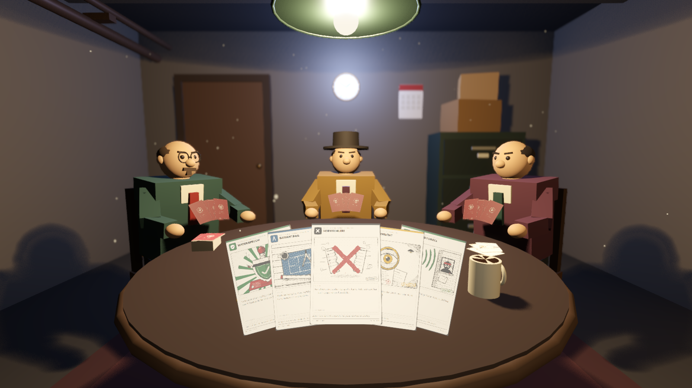

# Amt & Ordnung

Bürokratie-Satire als Kartenspiel. Dasselbe Deck in zwei Formen:

- **3D-Spiel** (Godot 4) — First-Person am Kellertisch. Vertical Slice, Regeln noch nicht implementiert.
- **Druckdeck** (PDF) — 65 Karten zum Papier-Testen, 8 Seiten A4.



---

## 3D-Spiel

### Starten

```powershell
godot --path .          # oder: Ordner in Godot 4.7 öffnen, F5
```

Beim ersten Start importiert Godot die Assets (einmalig ~30 s).

### Steuerung

| Eingabe | Wirkung |
|---|---|
| **Rechte Maustaste halten + bewegen** | umsehen (360°, Blickneigung begrenzt) |
| **Pfeiltasten / Q E** | umsehen ohne Maus |
| **Maus über einer Karte** | Karte hebt sich, Handkarten insgesamt etwas an |
| **Linke Maustaste** | Karte „spielen" (aktuell nur Log-Ausgabe) |
| **Esc** | beenden |

Die Maus bleibt sichtbar, damit die Karten ansteuerbar sind. Deshalb ist das Umsehen an
die rechte Maustaste gebunden — ein versteckter Zeiger und Karten-Hover schließen sich
technisch aus.

### Was schon steht

| | |
|---|---|
| Raum | 5,2 × 2,7 × 6,0 m Keller: Betonboden, Teppich, Rohre, Balken, Lampe, Regal, Heizkörper, Aktenschrank, Kisten, Tür, Uhr, Kalender, Schwarzes Brett |
| Tisch | runder Tisch mit 5 Karten als Hand, Ziehstapel links (26 Karten), Ablagestapel rechts |
| Gegner | 3 Figuren aus Primitiven, je mit eigenem Kartenfächer, Blickbewegung und Atmung |
| Hand | 5 Karten als Fächer im Kameraraum, Anheben per Raycast auf Karten-Kollisionskörper |
| Licht | warme Hängelampe mit Schatten, zwei Funzeln, kühles Gegenlicht, Staubpartikel, SSAO, DOF |

### Debug: Screenshots ohne Maus

```powershell
# ruhige Aufnahme
godot --path . --resolution 1600x900 -- --screenshot --out=res://out/game/shot.png

# mit angehobener Karte 1, gedrehter Kamera und eingeblendetem Hinweis
godot --path . --resolution 1600x900 -- --screenshot --hover=1 --yaw=-14 --pitch=-9 --hud `
      --out=res://out/game/shot-hover.png

# prüft, ob der Maus-Raycast alle Handkarten trifft
godot --path . --resolution 1600x900 -- --selftest

# lässt 120 Frames der normalen Spielschleife laufen (Eingabe, Hint, Animation) und beendet
godot --path . --resolution 1600x900 -- --smoke
```

`--selftest` gibt pro Karte die getroffene ID aus. Erwartung: `Hover-Test: 5 von 5 Karten
korrekt getroffen`. Nach jeder Änderung an Hand, Kamera oder Kollision erneut laufen lassen.

### Aufbau

```
project.godot              Godot-Projekt (Forward+, 1600 × 900)
scenes/main.tscn           Einstiegsszene, nur ein Node3D mit Skript
src/main.gd                Kamera, Licht, Aufbau, Eingabe, Screenshot/Selftest
src/room.gd                Keller, Möbel, Tisch, Kartenstapel, Staub
src/bot.gd                 Gegnerfigur aus Primitiven
src/hand.gd                Kartenfächer, Hover-Raycast, Animation
src/scene_kit.gd           Primitiv-Baukasten (Meshes, Materialien, Licht, Stuhl)
assets/faces/*.png         Kartenvorderseiten + Rückseite als Texturen (714 × 999 px)
```

Alles Geometrische wird im Code gebaut — es gibt keine Modell-Dateien. Das ist Absicht:
so bleibt der Prototyp ohne 3D-Modellierung änderbar.

### Kartenoberflächen neu rendern

Die Texturen entstehen aus derselben HTML-Vorlage wie das Druck-PDF, damit Spiel und
Papierdeck identisch aussehen:

```powershell
python tools/build-cards/faces.py
```

Ändert man `data/cards.json` oder `style.css`, danach **beides** neu bauen: `faces.py`
für das Spiel, `build.py` für das PDF.

---

## Druckdeck

| Datei | Zweck |
|---|---|
| `out/amt-und-ordnung-karten.pdf` | **Druckvorlage**, 8 Seiten A4 |
| `out/preview-sheet1.png` | Bildschirmvorschau Seite 1 |
| `out/preview-detail.png` | Nahaufnahme von 3 Karten |
| `build/cards.html` | HTML-Quelle (im Browser ansehbar) |

### Drucken

1. PDF auf **A4, 100 % Skalierung** drucken (nicht „an Seite anpassen").
2. **250–300 g/m²** Karton.
3. An den Kartenkanten schneiden: 63 × 88 mm (Standard-TCG-Format).
4. In **63,5 × 88,9 mm Sleeves** stecken — dann sind die Karten gemischt und fühlen sich echt an.

### Karten ändern

Alles Inhaltliche steht in `data/cards.json` — Text, Anzahl, Farbe, Icon:

```json
{
  "id": "widerspruch",
  "name": "Widerspruch",
  "category": "rettung",
  "copies": 6,
  "icon": "schild",
  "effect": "Entschärfe einen Auflagenbescheid. …",
  "flavor": "Frist: ein Monat. Sie haben vier Sekunden.",
  "art": "widerspruch"
}
```

### Grafik

Die 14 Illustrationen liegen als PNG in `art/`. Der Builder skaliert sie beim Einbau auf
1100 px Breite und bettet sie als JPEG ein — sonst würde das PDF durch die 65-fache
Verwendung explodieren.

Ersetzen ohne Codeänderung: `art/<id>.png` austauschen (oder `.jpg` / `.webp` daneben
legen). Die SVGs sind nur Fallback, falls ein Bild fehlt.

- Format: 16:9, mindestens 900 px breit
- Der Bildausschnitt wird mittig auf 57 × 40 mm beschnitten (`background-size: cover`)
- IDs stehen im Feld `art` in `cards.json`
- Bild-Briefing: `art/PROMPTS.md`

---

## Struktur

```
amt-und-ordnung/
├── project.godot            Godot-Projekt
├── scenes/ src/             erscheint oben
├── assets/faces/            Karten-Texturen für das 3D-Spiel
├── data/cards.json          Karteninhalte (Quelle für Spiel und Druck)
├── art/                     Illustrationen (vom 3D-Spiel ignoriert, .gdignore)
├── tools/build-cards/
│   ├── art_gen.py           erzeugt die 14 SVG-Platzhalter + Icons
│   ├── style.css            Kartenlayout (63 × 88 mm)
│   ├── build.py             JSON → HTML → PDF
│   ├── faces.py             JSON → PNG-Texturen für das Spiel
│   └── preview.py           PNG-Vorschauen
├── build/cards.html         generiert
├── out/                     PDF, Vorschauen, Spiel-Screenshots
└── docs/GDD.md              Game Design Document
```

## Layout der Karte

| Zone | Höhe | Inhalt |
|---|---|---|
| Kopf | 10 mm | Symbol (7 mm) oben links, Formularzeile, Kartentitel |
| Artwork | 40 mm | Comic-Illustration, Kategorie-Stempel unten rechts |
| Wirkung | flexibel | Effekttext im Formularfeld |
| Flavor | ~5 mm | kursiver Begleittext |
| Fußzeile | 4,5 mm | Kartennummer, Anzahl im Deck |

## Voraussetzungen

- **Godot 4.7** für das 3D-Spiel
- Python 3.10+ für Druckvorlage und Karten-Texturen
- `playwright` (`pip install playwright`) — nutzt das installierte Chrome, kein Browser-Download
- `pillow` (`pip install pillow`) — verkleinert die Illustrationen für den Druck
